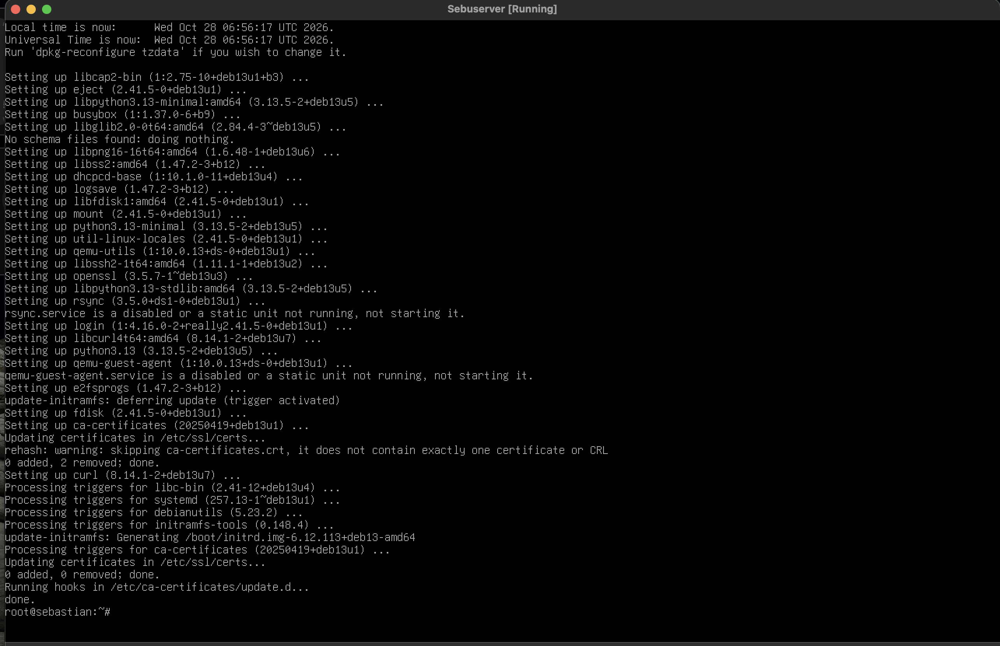
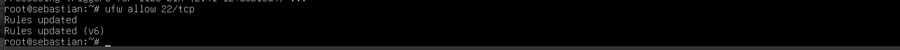
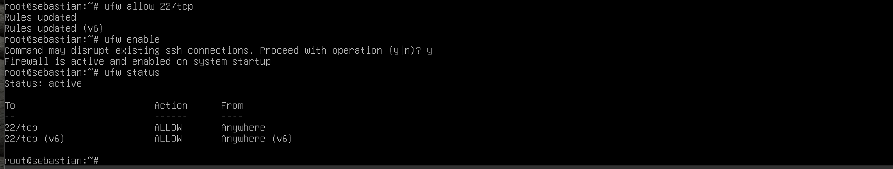
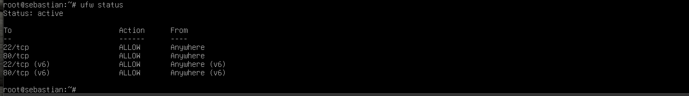
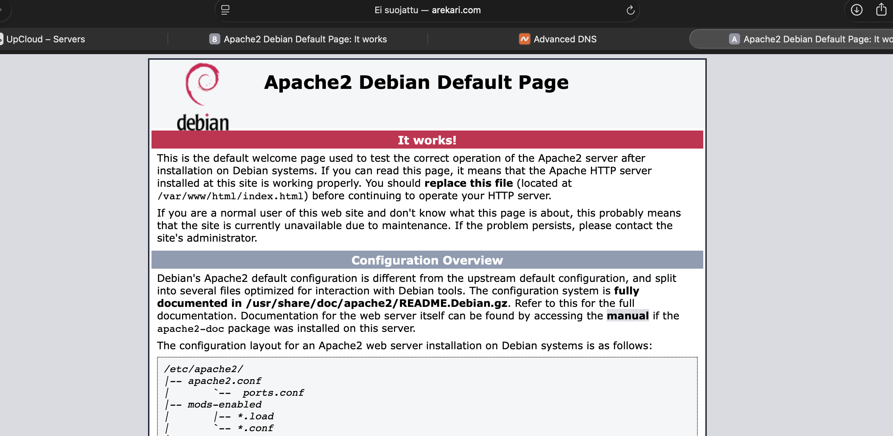

# H0 – Oikeasti netissä

## x) Lukutehtävät

### Niemi (2025): H4 Tehtävät

Materiaalissa käsitellään Linux-palvelimen hallintaa ja tietoturvaa. Palvelimen ylläpidossa on tärkeää päivittää ohjelmistot, hallita käyttäjäoikeuksia ja rajoittaa verkkoyhteyksiä palomuurilla. Tarvittavat yhteydet tulee sallia ennen palomuurin käyttöönottoa, jotta etähallinta ei esty.

### Partanen (2025): Harjoitus 5 – Nimekäs
Harjoituksessa käsitellään verkkotunnuksen yhdistämistä palvelimeen DNS-asetusten avulla. A-tietueella verkkotunnus ohjataan palvelimen IPv4-osoitteeseen. @ tarkoittaa juuriverkkotunnusta, ja www-tietueella voidaan ohjata myös www-alkuinen osoite samaan palvelimeen.

## a) Debian 13:n asentaminen virtuaalikoneeseen

Asensin Debian 13:n paikalliseen virtuaalikoneeseen. Asennuksen jälkeen loin SSH-avainparin komennolla:
ssh-keygen -t ed25519

Julkisen avaimen tarkistin komennolla:
cat ~/.ssh/id_ed25519.pub

Julkista avainta voidaan käyttää palvelimelle kirjautumiseen. Yksityinen avain pitää säilyttää turvallisesti omalla koneella.

**Kuva 1.** SSH-avainparin luominen.

## b) Virtuaalipalvelimen vuokraaminen
Otin käyttöön UpCloudin virtuaalipalvelimen, jossa käytetään Debiania. Palvelimen julkinen IP-osoite on 81.27.96.102.
Palvelimen avulla pystyin julkaisemaan verkkopalvelun internetiin ja testaamaan sitä oman tietokoneeni selaimella.

**Kuva 2.** UpCloud-palvelin.

`

## c) Palvelimen alkuasetukset ja palomuuri
Päivitin palvelimen pakettitiedot ja ohjelmistot:

sudo apt update
sudo apt upgrade

Tämän jälkeen sallin SSH-yhteydet UFW-palomuurissa:
sudo ufw allow 22/tcp
sudo ufw enable
sudo ufw status

SSH-portin salliminen ennen palomuurin aktivointia on tärkeää, jotta etäyhteys palvelimelle säilyy. Tarkistin lopuksi, että palomuuri oli aktiivinen ja portti 22 sallittu.
Myöhemmin sallin myös HTTP-liikenteen porttiin 80 verkkopalvelinta varten.

**Kuva 3.** SSH-portin salliminen.

**Kuva 4.** UFW-palomuuri ja sallitut portit.

## d) Apache-verkkopalvelimen asentaminen
Asensin Apache-verkkopalvelimen komennolla:
sudo apt install apache2

Sallin HTTP-liikenteen porttiin 80:
sudo ufw allow 80/tcp
sudo ufw status

Testasin palvelimen avaamalla selaimessa osoitteen http://81.27.96.102. Selaimessa näkyi Apachen oletussivu, mikä vahvisti, että verkkopalvelin vastasi pyyntöihin.

**Kuva 5.** Apache-palvelimen oletussivu.

## e) Verkkotunnuksen yhdistäminen palvelimeen

Yhdistin verkkotunnuksen arekari.com palvelimen IP-osoitteeseen DNS-asetuksilla. Määritin seuraavat A-tietueet:

| @ | 81.27.96.102 |
| www | 81.27.96.102|
Näin sekä arekari.com että www.arekari.com ohjautuvat samaan palvelimeen.

Testasin verkkotunnuksen selaimessa, ja Apachen oletussivu avautui myös osoitteella arekari.com. Tässä vaiheessa palvelimella oli vielä Apachen oletussivu oman verkkosivun sijaan.

**Kuva 6.** Verkkotunnuksen DNS-asetukset.

**Kuva 7.** Apache-sivu verkkotunnuksella.

