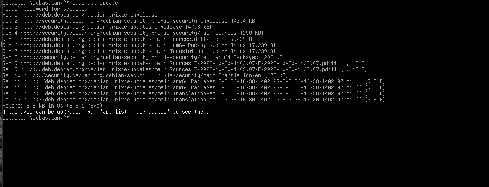
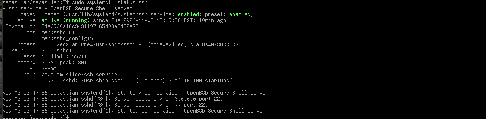
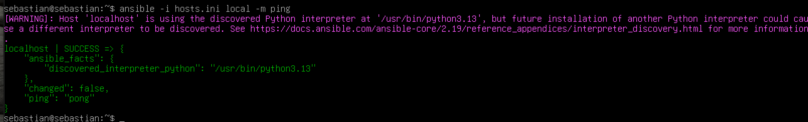
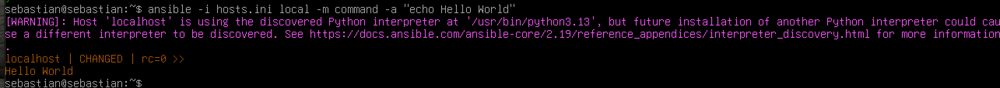

# H1 Hei Ansiblen maailma

## x) Lukutehtävät

### Karvinen (2026): SSH Public Key Login Without a Password

- Artikkelissa kerrotaan, miten SSH-yhteyden voi muodostaa julkisen avaimen avulla ilman salasanan kirjoittamista jokaisella kirjautumiskerralla.
- SSH-avainpariin kuuluu julkinen ja yksityinen avain. Julkinen avain siirretään palvelimelle ja yksityinen avain säilytetään omalla koneella.
- Avainten luomiseen käytetään `ssh-keygen`-komentoa ja julkisen avaimen siirtämiseen `ssh-copy-id`-komentoa.

- **Oma huomio:** Aihe oli minulle hyödyllinen, koska pääsin kokeilemaan samoja komentoja käytännössä tässä tehtävässä. Huomasin, että avainkirjautuminen helpottaa kirjautumista huomattavasti. Erityisesti siitä on hyötyä silloin, kun yhteyksiä käytetään automaation kanssa.

### Karvinen (2026): Hello Ansible

- Artikkelissa esitellään Ansible, jolla voidaan hallita palvelimia ja suorittaa niillä komentoja etänä.
- Ansible käyttää SSH-yhteyttä palvelimelle, joten erillistä Ansible-ohjelmaa ei tarvitse asentaa hallittavalle koneelle.
- Artikkelissa näytetään myös, miten yhteyden toimivuus voidaan tarkistaa `ping`-moduulilla ja miten palvelimella voidaan suorittaa komentoja.

- **Oma huomio:** En ollut aikaisemmin käyttänyt Ansiblea, joten artikkeli auttoi ymmärtämään sen perusidean. Tehtävää tehdessäni kokeilin yhteyden testaamista ja Hello World -tekstin tulostamista. Oli mukava huomata, että sain komennot toimimaan ilman, että minun tarvitsi kirjautua palvelimelle erikseen tekemään niitä.

## a) Paikallista

Asensin Debian 13 -käyttöjärjestelmän paikallisesti VirtualBox-virtuaalikoneeseen jo H0-tehtävän yhteydessä. Käytin samaa virtuaalikonetta myös tässä tehtävässä.

Aiempi asennusraportti: [H0-raportti](LISÄÄ_H0_RAPORTIN_LINKKI)

## b) Sshsecrets

Aloitin päivittämällä Debianin pakettiluettelot komennolla:

sudo apt update

 

Tämän jälkeen tarkistin ja asensin SSH-palvelimen komennolla:

sudo apt install openssh-server

SSH-palvelin oli jo valmiiksi asennettuna järjestelmään, joten erillistä asennusta ei tarvittu.

Tarkistin SSH-palvelun toiminnan komennolla:

sudo systemctl status ssh

Tulosteesta näkyi, että palvelu oli aktiivinen ja käynnissä (`active (running)`). Tämän jälkeen testasin SSH-yhteyttä omaan koneeseen:

ssh localhost

Kirjautuminen onnistui, joten SSH-yhteys toimi oikein.

## c) Pubkey

Seuraavaksi otin käyttöön uuden SSH-avainparin, jotta kirjautuminen onnistuisi ilman käyttäjän salasanan kysymistä.

Loin uuden Ed25519-avainparin komennolla:

ssh-keygen -t ed25519 -f ~/.ssh/h1_ansible

Julkinen avain tallentui tiedostoon h1_ansible.pub ja yksityinen avain tiedostoon h1_ansible.

Kopioin julkisen avaimen palvelimelle komennolla:

ssh-copy-id -i ~/.ssh/h1_ansible.pub localhost

Komento ilmoitti, että yksi avain lisättiin onnistuneesti.

Testasin tämän jälkeen kirjautumista uudella avaimella:

ssh -i ~/.ssh/h1_ansible -o PasswordAuthentication=no localhost

Kirjautuminen onnistui ilman käyttäjän salasanan tai avaimen passphrasen kysymistä. SSH-avainkirjautuminen toimi siis odotetusti.

## d) Hei Ansible

Viimeisessä kohdassa asensin Ansiblen Debianiin komennolla:

sudo apt install ansible

Tarkistin asennuksen onnistumisen:

ansible --version

Asennettu Ansible-versio oli 2.19.11.

Seuraavaksi loin hosts.ini-tiedoston ja määritin siihen paikallisen koneen sekä käytettävän SSH-avaimen:

[local]
localhost ansible_connection=ssh ansible_user=sebastian ansible_ssh_private_key_file=/home/sebastian/.ssh/h1_ansible

Testasin Ansible-yhteyden komennolla:

ansible -i hosts.ini local -m ping

Testi onnistui ja Ansible palautti vastauksen "pong". Tämä osoitti, että Ansible pystyi muodostamaan SSH-yhteyden koneeseen.

Lopuksi suoritin Hello World -testin:

ansible -i hosts.ini local -m command -a "echo Hello World"

Komento onnistui ja tulosteena oli:

localhost | CHANGED | rc=0 >>
Hello World

Näin sain testattua Ansiblen toimintaa SSH-yhteyden kautta onnistuneesti.

## Lähteet

- Karvinen, Tero. SSH Public Key Login Without a Password. https://terokarvinen.com/ssh-public-key-login-without-password/
- Karvinen, Tero. Hello Ansible. https://terokarvinen.com/hello-ansible/
- Debian Wiki. SSH. https://wiki.debian.org/SSH
- Debian Wiki. Ansible. https://wiki.debian.org/Ansible
- Ansible Documentation. Installing Ansible on specific operating systems. https://docs.ansible.com/projects/ansible/latest/installation_guide/installation_distros.html
- Debian Wiki. Setup SSH Passwordless Login. https://wiki.debian.org/Setup%20SSH%20Passwordless%20Login
