# H2 – Voileipä: Ansible ja Linux-palvelimen hallinta

## Johdanto

Tehtävän tavoitteena oli oppia käyttämään Ansiblea Linux-palvelimen hallintaan ja ymmärtää, kuinka tavallisia ylläpitotehtäviä voidaan automatisoida.

Työskentelin käyttäjällä sebastian, joka toimi Ansible-ohjauskoneena. Hallittavana käyttäjänä käytin antero-käyttäjää. Ansible suoritti tehtävät paikalliselle koneelle SSH-yhteyden kautta (localhost).

---

## x) Tiivistelmät ja moduuleihin tutustuminen

### Sudo without password

Artikkelissa käsitellään salasanattoman sudo-oikeuden määrittämistä Linuxissa. Käyttäjälle voidaan antaa oikeus suorittaa ylläpitäjän komentoja ilman salasanan kysymistä. Tämä helpottaa esimerkiksi Ansible-automaatiota, jossa komentoja suoritetaan ilman jatkuvaa manuaalista kirjautumista.

### xkcd 149 – Sandwitch

Sarjakuva käsittelee huumorilla Linuxin sudo-oikeuksia. Siinä käyttäjä pyytää järjestelmää tekemään voileivän ja saa vastaukseksi, että hänen täytyy käyttää sudo-komentoa. 

### Passwordless Sudo with Ansible

Artikkelissa esitellään, kuinka salasanaton sudo-oikeus voidaan määrittää Ansiblella. Ansiblella voidaan luoda käyttäjä, määrittää hänelle tarvittavat ryhmät ja lisätä sudo-oikeudet automaattisesti. Näin järjestelmän asetukset voidaan tehdä ilman manuaalisia komentoja.

### Ansible-moduuleihin tutustuminen

Tutustuin Ansible-moduulien dokumentaatioon ansible-doc-komennolla. Seuraavat moduulit ovat hyödyllisiä palvelimen hallinnassa:

- copy: Kopioi tiedostoja tai luo tiedostoja suoraan määritellyllä sisällöllä. Parametreilla voidaan määrittää esimerkiksi kohdepolku, omistaja ja käyttöoikeudet.
- apt: Hallitsee Debian- ja Ubuntu-järjestelmien ohjelmistopaketteja. Parametreilla name ja state voidaan määrittää asennettava ohjelma ja sen tila. update_cache päivittää pakettivarastojen tiedot.
- file: Hallitsee tiedostoja, hakemistoja ja symbolisia linkkejä. Parametreilla voidaan määrittää esimerkiksi polku, omistaja, ryhmä ja käyttöoikeudet.
- user: Luo, muokkaa ja poistaa käyttäjätilejä. Parametreilla voidaan määrittää esimerkiksi käyttäjänimi, kotihakemisto, ryhmät ja komentotulkki.
- authorized_key: Lisää käyttäjän SSH-julkisen avaimen authorized_keys-tiedostoon, jolloin käyttäjä voi kirjautua palvelimelle SSH-avaimella.


---

## a) Salasanaton sudo

Ensimmäisessä tehtävässä loin uuden käyttäjän nimeltä antero ja määritin hänelle salasanattoman sudo-oikeuden. Tätä varten loin ensin käyttäjän ja uuden sudoless-ryhmän, johon lisäsin käyttäjän. Ryhmän avulla voidaan määrittää sudo-oikeudet usealle käyttäjälle keskitetysti.

Loin käyttäjän komennolla:


**sudo adduser antero**


Seuraavaksi loin ryhmän ja lisäsin käyttäjän siihen:

**sudo addgroup sudoless
sudo usermod -aG sudoless antero**


Tarkistin vielä, että käyttäjä oli lisätty oikeaan ryhmään:


**groups antero**


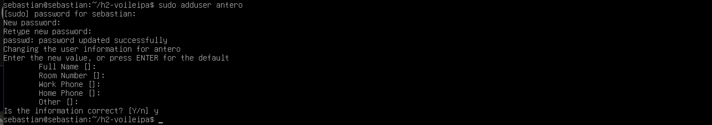

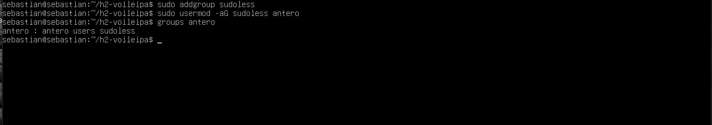

Seuraavaksi määritin ryhmälle salasanattoman sudo-oikeuden luomalla uuden määritystiedoston hakemistoon /etc/sudoers.d/.


**sudo visudo -f /etc/sudoers.d/sudoless**


Lisäsin tiedostoon seuraavan rivin:


**%sudoless ALL=(ALL:ALL) NOPASSWD: ALL**


Määritys tarkoittaa, että sudoless-ryhmään kuuluvat käyttäjät voivat suorittaa komentoja sudolla ilman salasanan kysymistä.

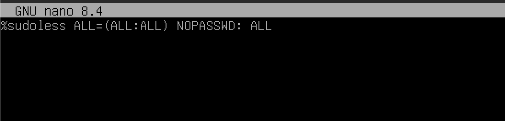

Tämän jälkeen varmistin, että tiedoston käyttöoikeudet olivat oikeat. Sudoers-tiedoston oikeuksien tulee olla rajatut, jotta muut käyttäjät eivät voi muokata sitä.


**sudo chmod 0440 /etc/sudoers.d/sudoless
sudo visudo -c**


Lopuksi testasin, että käyttäjä pystyi suorittamaan sudo-komentoja ilman salasanan kysymistä:


**sudo -u antero sudo whoami**

Komento tulosti root, mikä osoitti, että salasanaton sudo-oikeus toimi oikein.

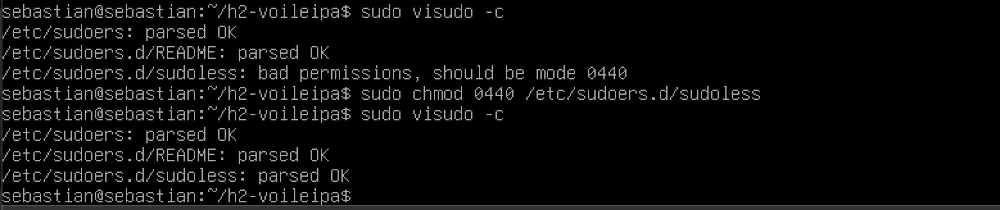

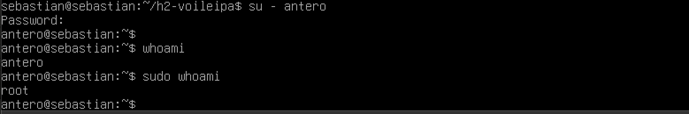

## b) Salasanaton SSH-kirjautuminen Ansiblella

Toisessa tehtävässä toteutin käyttäjän antero luomisen ja SSH-kirjautumisen määrittämisen Ansiblella. Tavoitteena oli, että käyttäjä pystyy kirjautumaan palvelimelle SSH-avaimella ilman salasanan syöttämistä.

Loin Ansible-projektiin roolin nimeltä antero. Roolin tehtävät määritin tiedostoon roles/antero/tasks/main.yml. Tehtävätiedostossa käytin muun muassa group-, user-, authorized_key- ja copy-moduuleja.

Group-moduulilla luodaan tarvittava ryhmä ja user-moduulilla käyttäjä. Authorized_key-moduulilla lisätään käyttäjän julkinen SSH-avain tämän kotihakemiston valtuutettujen avainten tiedostoon. Copy-moduulilla voidaan puolestaan kopioida tarvittavia tiedostoja palvelimelle.

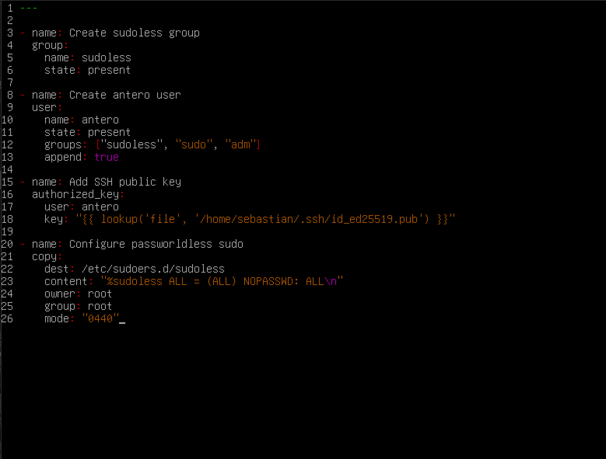

Tämän jälkeen määritin site.yml-tiedostoon, että Ansible suorittaa antero-roolin kaikille inventaariossa määritetyille palvelimille. Käytin myös become: true -asetusta, jotta tehtävät voitiin suorittaa tarvittavilla ylläpitäjän oikeuksilla.


Suoritin playbookin seuraavalla komennolla:


**ansible-playbook -i hosts.ini site.yml --ask-become-pass**


Playbook suoritti määritetyt tehtävät onnistuneesti. Näin Ansible loi käyttäjän ja määritti SSH-avaimen käyttöön.

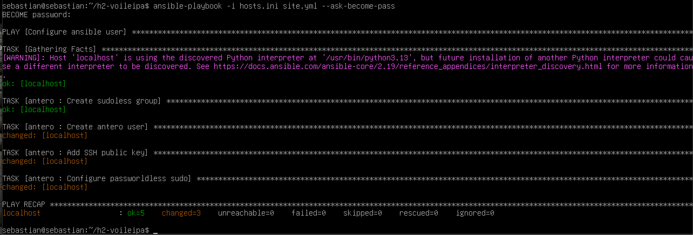

Lopuksi testasin SSH-kirjautumisen käyttäjällä antero:


**ssh antero@localhost**


Kirjautumisen jälkeen testasin vielä sudo-oikeuden toiminnan:


**sudo -k**
**sudo whoami**


Komento tulosti root, joten sekä SSH-kirjautuminen että salasanaton sudo toimivat onnistuneesti.

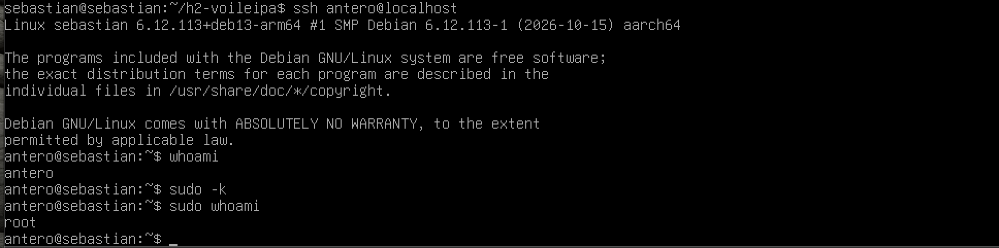

## c) Ohjelmistojen asentaminen Ansiblella

Kolmannessa tehtävässä asensin kaksi ohjelmistoa Ansiblella. Valitsin asennettaviksi ohjelmiksi treen ja cowsayn. Käytin asennukseen Ansible-ohjelman apt-moduulia, jonka avulla voidaan hallita Debian-pohjaisten järjestelmien paketteja.

Määritin tehtävät Ansible-roolin tehtävätiedostoon. Apt-moduulissa käytin name-asetusta määrittämään asennettavat paketit ja state: present -asetusta varmistamaan, että paketit ovat asennettuina. Lisäksi käytin update_cache: true -asetusta, joka päivittää pakettivarastojen tiedot ennen asennusta.

Suoritin asennukset playbookin avulla:


**ansible-playbook -i hosts.ini site.yml --ask-become-pass**


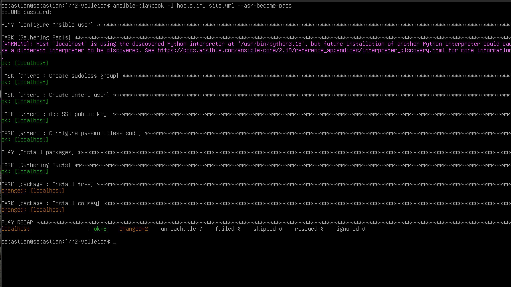

Asennuksen jälkeen tarkistin, että ohjelmat toimivat oikein. Testasin treen version seuraavalla komennolla:


**tree --version**


Cowsay-ohjelman testasin tulostamalla sillä viestin:


**cowsay "Ansible toimii!"**


Molemmat ohjelmat toimivat odotetusti, joten asennus onnistui.


## d) Tiedoston kopioiminen ja oikeuksien määrittäminen

Neljännessä tehtävässä loin Ansiblella monirivisen tekstitiedoston ja määritin sille omistajan, ryhmän sekä käyttöoikeudet. Käytin tehtävässä copy-moduulia, jolla voidaan luoda tai kopioida tiedostoja palvelimelle.

Määritin tiedoston sisällön content-asetuksella ja kohdepolun dest-asetuksella. Lisäksi asetin tiedoston omistajaksi ja ryhmäksi antero-käyttäjän. Käyttöoikeudet määritin oktaalimuodossa arvolla 0640.

Alla on esimerkki käytetystä YAML-määrityksestä:

```yaml
---
- name: Copy example file
  copy:
    dest: /home/antero/esimerkki.txt
    content: |
      Tämä on Ansiblella kopioitu tiedosto.
      Tiedoston omistaja ja ryhmä määritetään erikseen.
      Tiedoston käyttöoikeudet asetetaan oktaalimuodossa.
    owner: antero
    group: antero
    mode: "0640"
```

Käyttöoikeus 0640 tarkoittaa, että tiedoston omistajalla on luku- ja kirjoitusoikeus, ryhmällä on lukuoikeus ja muilla käyttäjillä ei ole oikeuksia tiedostoon.

Symbolisessa muodossa oikeudet ovat rw-r-----. Oktaalimuodossa numero 6 tarkoittaa luku- ja kirjoitusoikeutta, numero 4 lukuoikeutta ja numero 0 sitä, ettei käyttöoikeuksia anneta.

Suoritin playbookin ja tarkistin, että tiedosto luotiin onnistuneesti oikeaan hakemistoon.

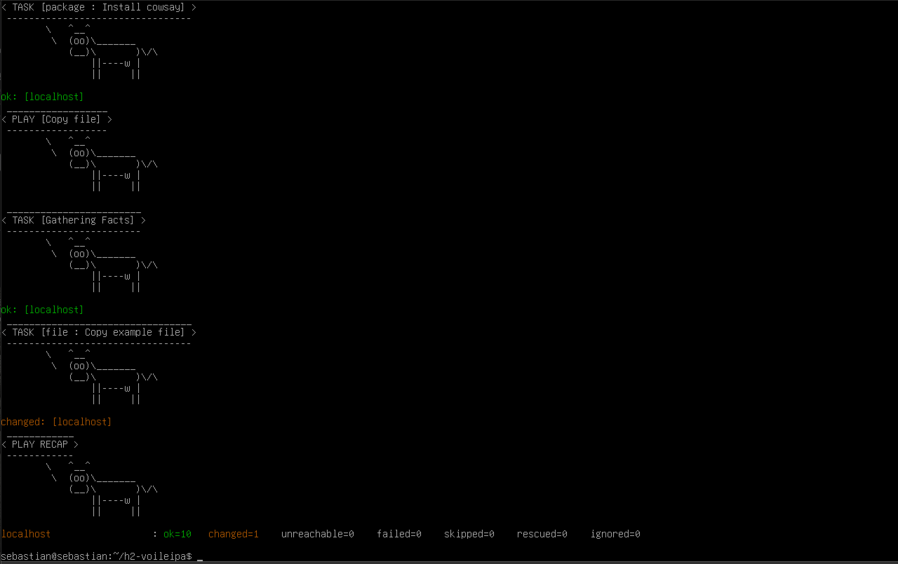

Tarkistin lopuksi tiedoston sisällön ja varmistin, että tiedosto oli luotu oikeilla tiedoilla.


## e) Debug-moduulin käyttäminen

Tässä tehtävässä käytin Ansible-ohjelman debug-moduulia, jolla voidaan tulostaa viestejä playbookin suorittamisen aikana. Moduuli on hyödyllinen esimerkiksi tehtävien testaamisessa ja virheiden selvittämisessä. Sen avulla voidaan tarkistaa, että playbook suorittaa tehtävät halutussa järjestyksessä ja että tarvittavat tiedot tulostuvat oikein.

Lisäsin debug-moduulin Ansible-tehtävään, jossa tulostetaan itse määrittämäni viesti:

```yaml
- name: Test debug module
  debug:
    msg: "Ansible debug-moduuli toimii!"
```

Suoritin playbookin komennolla:


**ansible-playbook -i hosts.ini site.yml --ask-become-pass**


Playbookin suorittamisen jälkeen Ansible tulosti määrittämäni viestin terminaaliin. Tulosteen perusteella pystyin varmistamaan, että debug-moduuli toimi oikein. Tehtävä osoitti, kuinka Ansiblella voidaan tulostaa tietoa suorituksen aikana ilman, että palvelimelle tarvitsee luoda erillisiä tiedostoja.

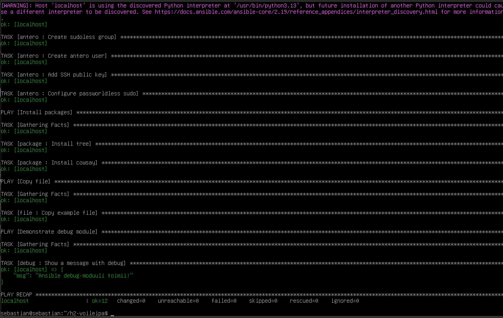
---


## Lähteet

- Karvinen, Tero. *Sudo without password*.
- Munroe, Randall. 2006. *xkcd 149 – Sandwitch*. https://xkcd.com/149/
- Karvinen, Tero. *Passwordless Sudo with Ansible*.
- ChatGTP:tä käytetty käsitteiden ja käskyjen avaamiseen

