# H3 – Demoni

---

## x) Tiivistelmät

### Apache installed with Ansible – quick notes

Tero Karvisen artikkelissa käsitellään Apache-web-palvelimen asentamista Ansiblella. Artikkelissa käydään läpi palvelimen asennuksen ja hallinnan perusperiaatteita. Ansiblella voidaan esimerkiksi asentaa ohjelmistoja, kopioida asetustiedostoja ja varmistaa, että palvelu on käynnissä.

Opin, että palvelimen hallinta voidaan jakaa eri osiin: ohjelmiston asentamiseen, asetusten määrittämiseen ja palvelun käynnistämiseen. Tämä tekee palvelimen käyttöönotosta helpommin toistettavaa.

### Ansible Documentation – Handlers

Ansible-dokumentaation handlers-osiossa käsitellään tehtäviä, jotka suoritetaan vain silloin, kun jokin toinen tehtävä ilmoittaa muutoksesta. Tästä käytetään `notify`-asetusta.

Esimerkiksi jos Ansible muuttaa Nginxin asetustiedostoa, se voi ilmoittaa handlerille, joka käynnistää Nginxin uudelleen. Handleria ei siis suoriteta turhaan jokaisella playbookin ajokerralla, vaan ainoastaan silloin, kun sitä tarvitaan.

### ansible-doc service

Tutustuin Debianin terminaalissa `ansible-doc service` -komennolla service-moduulin dokumentaatioon. Moduulilla voidaan hallita Linux-palveluita.

Keskeisiä asetuksia ovat:

- `name`: määrittää hallittavan palvelun nimen.
- `state`: määrittää palvelun halutun tilan, esimerkiksi `started` tai `stopped`.
- `enabled`: määrittää, käynnistyykö palvelu automaattisesti järjestelmän käynnistyessä.

Näitä asetuksia käytin myöhemmin Nginxin hallintaan Ansiblella.

---

**y) Hackernews: N-able korjaa 17 N-central-järjestelmän tietoturva-aukkoa**

Valitsin The Hacker News -sivustolta 17.11.2026 julkaistun uutisen, joka käsittelee N-ablen N-central-hallintajärjestelmästä löytyneitä tietoturva-aukkoja.

N-central on etähallinta-alusta, jonka avulla IT-ylläpitäjät voivat valvoa ja hallita laitteita etänä.

N-able julkaisi järjestelmälle tietoturvapäivityksen, joka korjaa yhteensä 17 haavoittuvuutta.

Haavoittuvuudet liittyivät muun muassa tunnistautumiseen, käyttöoikeuksiin, tiedostojen käsittelyyn ja palvelimen tietoturvaan.

Aiemmin löydettyjä haavoittuvuuksia oli jo hyödynnetty hyökkäyksissä, joissa haavoittuville palvelimille asennettiin kryptovaluuttojen louhintaohjelmia.

N-able suosittelee päivittämään palvelimet, agentit ja proberatkaisut uusimpiin versioihin, jotta järjestelmät olisivat suojattuja.

Oma huomio: Uutinen havainnollistaa, kuinka tärkeää keskitettyjen hallintajärjestelmien tietoturvasta huolehtiminen on. Niiden avulla voidaan hallita useita laitteita samasta paikasta, mutta samalla järjestelmään kohdistuva hyökkäys voi aiheuttaa ongelmia monille laitteille. Siksi päivityksistä ja käyttöoikeuksista huolehtiminen on tärkeää.

linkki: https://thehackernews.com/2026/11/n-able-patches-17-n-central-flaws-as.html? 

---

## a) Apassi

Ensimmäisessä tehtävässä asensin Apache-web-palvelimen Debianille. Apache on web-palvelinohjelmisto, jonka avulla voidaan julkaista verkkosivuja selaimella katseltavaksi.

Aloitin asentamalla Apachen paketinhallinnan avulla:

```bash
sudo apt update
sudo apt install apache2
```

`apt update` päivittää pakettilähteiden tiedot. `apt install apache2` asentaa Apache-palvelimen. `sudo` tarvitaan, koska ohjelmistojen asentaminen vaatii ylläpitäjän oikeudet.

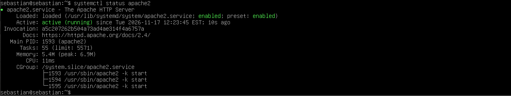

Asennuksen jälkeen tarkistin palvelun tilan:

```bash
systemctl status apache2
```

Komento näyttää, onko Apache käynnissä. Varmistin myös, että palvelin vastasi paikallisesti:

```bash
curl http://localhost
```

Curl-komennolla voidaan tehdä HTTP-pyyntö verkkopalvelimelle. Vastauksena sain verkkosivun HTML-sisällön.

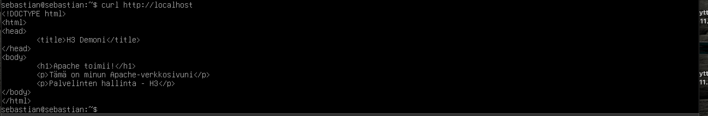


Seuraavaksi loin oman verkkosivuhakemiston ja HTML-tiedoston:

```bash
mkdir ~/publicsite
nano ~/publicsite/index.html
```

`mkdir` luo uuden hakemiston ja `nano` avaa tekstieditorin, jolla tiedostoa voidaan muokata. Tein `index.html`-tiedostoon yksinkertaisen verkkosivun, jossa oli otsikko ja tekstiä.

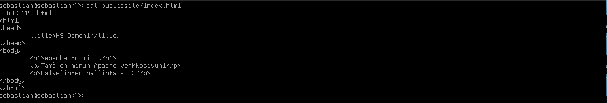


Jotta Apache näyttäisi oman verkkosivuni oletussivun sijasta, muokkasin Apachen oletussivuston asetustiedostoa:

```bash
sudo nano /etc/apache2/sites-available/000-default.conf
```

Muokkasin `DocumentRoot`-asetuksen osoittamaan omaan hakemistooni:

```apache
DocumentRoot /home/sebastian/publicsite

<Directory /home/sebastian/publicsite>
    Require all granted
</Directory>
```

`DocumentRoot` määrittää hakemiston, josta Apache hakee verkkosivun tiedostot. `Require all granted` sallii verkkopalvelimen käyttää kyseistä hakemistoa.


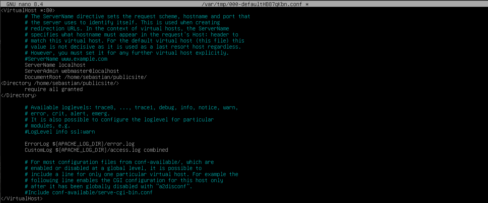


Tarkistin asetusten oikeellisuuden ennen palvelimen uudelleenkäynnistämistä:

```bash
sudo apache2ctl configtest
```

Komento tarkistaa Apachen asetustiedoston syntaksin. Tuloksena sain ilmoituksen `Syntax OK`, joten asetuksissa ei ollut havaittuja syntaksivirheitä.

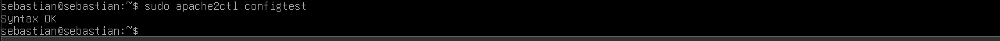

Seuraavaksi määritin hakemistojen ja tiedoston käyttöoikeudet:

```bash
chmod ugo+x /home/sebastian/
chmod ugo+x /home/sebastian/publicsite/
chmod ugo+r /home/sebastian/publicsite/index.html
```

`chmod` muuttaa tiedostojen ja hakemistojen käyttöoikeuksia. Hakemistoihin annettu `x`-oikeus mahdollistaa niiden läpi kulkemisen. HTML-tiedoston `r`-oikeus sallii sen lukemisen.

Tarkoituksena oli, että oma käyttäjäni pystyy muokkaamaan verkkosivua ilman sudo-oikeuksia ja Apache pystyy lukemaan sen sisällön.


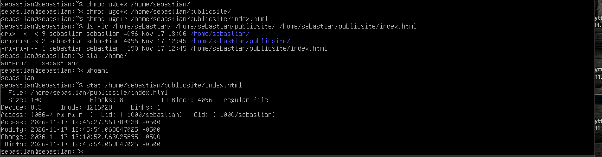

Lopuksi testasin verkkosivun toiminnan selaimella. VirtualBoxin NAT-verkkotilaan oli määritetty porttiohjaus, jonka avulla pääsin virtuaalikoneen web-palvelimelle Macin selaimesta osoitteella `http://localhost:8080`.

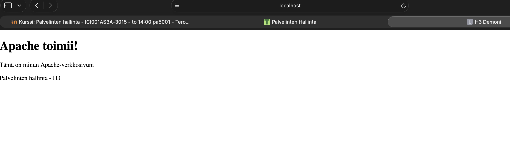

---

## b) Moottorix

Toisessa tehtävässä asensin Nginx-web-palvelimen. Nginx on Apacheen verrattava web-palvelinohjelmisto, jolla voidaan julkaista verkkosivuja.

Ennen Nginxin asentamista pysäytin Apachen, koska molemmat palvelimet yrittäisivät käyttää samaa oletusporttia 80:

```bash
sudo systemctl stop apache2
```

`systemctl stop` pysäyttää määritetyn palvelun.

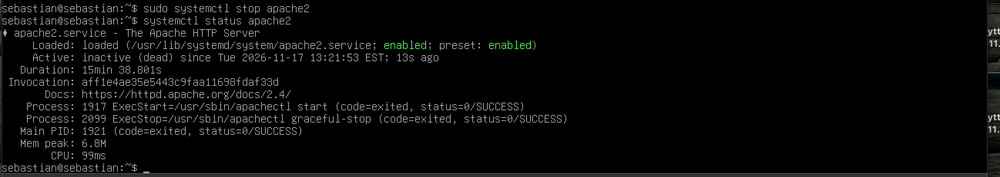

Asensin Nginxin seuraavilla komennoilla:

```bash
sudo apt update
sudo apt install nginx
```

Tämän jälkeen tarkistin Nginxin tilan:

```bash
systemctl status nginx
```


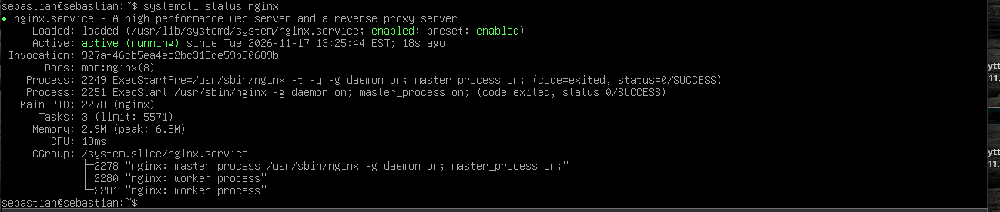

Seuraavaksi muokkasin Nginxin oletussivuston asetustiedostoa:

```bash
sudo nano /etc/nginx/sites-available/default
```

Etsin tiedostosta `root`-asetuksen ja vaihdoin sen osoittamaan aiemmin luomaani verkkosivuhakemistoon:

```nginx
root /home/sebastian/publicsite;
```

`root` määrittää hakemiston, josta Nginx hakee verkkosivun tiedostot. Näin molemmat web-palvelimet käyttävät samaa HTML-tiedostoa.


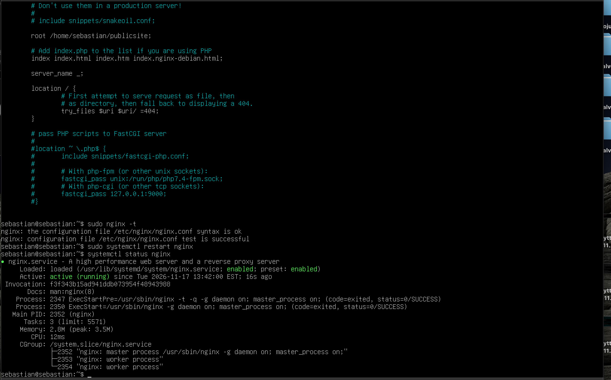

Tarkistin asetustiedoston syntaksin:

```bash
sudo nginx -t
```

Komento tarkistaa Nginxin asetukset ennen niiden käyttöönottoa. Tuloksena sain ilmoituksen, että syntaksi oli kunnossa ja testi onnistui.

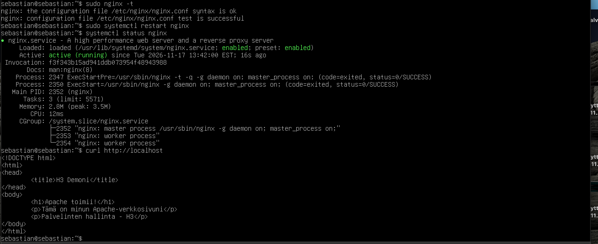

Tämän jälkeen varmistin, että Nginx oli käynnissä ja Apache pysäytettynä:

```bash
systemctl is-active nginx apache2
```

Komento tulosti Nginxin kohdalla `active` ja Apachen kohdalla `inactive`. Tämä varmisti, että Nginx oli käytössä ja Apache ei ollut käynnissä.

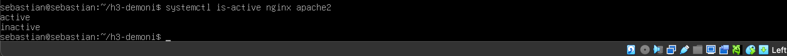

Testasin vielä verkkosivun toiminnan selaimella osoitteessa `http://localhost:8080`. Sivu avautui onnistuneesti myös Nginxin kautta. Tuli kuitenkin vielä apachen teksti ja en saanut sitä korjattua.


---

## c) Automoottorix

Kolmannessa tehtävässä automatisoin Nginxin asennuksen ja käynnistämisen Ansiblella. Ansiblella voidaan hallita Linux-palvelimia playbook-tiedostojen avulla. Playbook sisältää YAML-muodossa määritellyt tehtävät, jotka Ansible suorittaa järjestyksessä.

Loin tehtävää varten oman projektihakemiston:

```bash
mkdir ~/h3-demoni
cd ~/h3-demoni
```

`mkdir` luo projektihakemiston ja `cd` siirtyy siihen.


Loin projektihakemistoon inventaariotiedoston:

```bash
nano hosts.ini
```

Lisäsin tiedostoon seuraavan rivin:

```ini
localhost
```

Inventaario kertoo Ansibelle, mitä koneita hallitaan. Tässä tehtävässä käytin paikallista Debian-virtuaalikonetta, joten kohteena oli `localhost`.


Testasin yhteyden Ansiblella:

```bash
ansible all -m ping -i hosts.ini
```

Komennossa `-m ping` suorittaa Ansible-ping-moduulin ja `-i hosts.ini` määrittää käytettävän inventaariotiedoston. Tulokseksi sain `SUCCESS` ja `pong`, mikä osoitti, että Ansible pystyi suorittamaan tehtäviä paikallisella koneella.

Ansible-yhteyden testaaminen
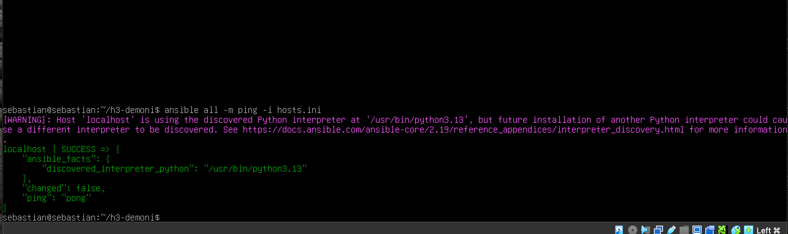
Tutustuin myös apt-moduulin dokumentaatioon:

```bash
ansible-doc apt
```

Komento avaa apt-moduulin ohjeet. Sen avulla tarkistin, miten ohjelmistopaketteja hallitaan Ansiblella.


Seuraavaksi loin playbook-tiedoston:

```bash
nano site.yml
```

Kirjoitin tiedostoon seuraavan sisällön:

```yaml
---
- name: Install and Start Nginx
  hosts: localhost
  become: yes

  tasks:
    - name: Install nginx
      apt:
        name: nginx
        state: present
        update_cache: yes

    - name: Start and enable nginx
      service:
        name: nginx
        state: started
        enabled: yes
```

Playbookin alussa määritetään tehtävän nimi ja kohdekone. `become: yes` tarkoittaa, että Ansible suorittaa tehtävät ylläpitäjän oikeuksilla.

Ensimmäisessä tehtävässä käytetään `apt`-moduulia Nginxin asentamiseen. `name: nginx` määrittää asennettavan paketin, `state: present` varmistaa, että paketti on asennettuna ja `update_cache: yes` päivittää pakettivarastojen tiedot.

Toisessa tehtävässä käytetään `service`-moduulia. `state: started` varmistaa, että Nginx on käynnissä. `enabled: yes` puolestaan määrittää, että palvelu käynnistyy automaattisesti järjestelmän käynnistyessä.


site.yml-tiedoston sisältö
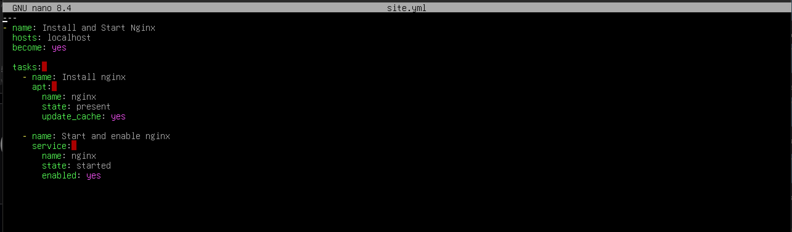
Tarkistin vielä service-moduulin dokumentaation:

```bash
ansible-doc service
```

Komento avaa palveluiden hallintaan tarkoitetun moduulin ohjeet. Tutustuin erityisesti asetuksiin `name`, `state` ja `enabled`, joita käytin playbookissa.


Ennen playbookin suorittamista tarkistin YAML-tiedoston syntaksin:

```bash
ansible-playbook -i hosts.ini site.yml --syntax-check
```

`--syntax-check` tarkistaa playbookin rakenteen ja syntaksin suorittamatta varsinaisia tehtäviä. Komento ilmoitti, että playbook oli kunnossa.

Playbookin syntax-check
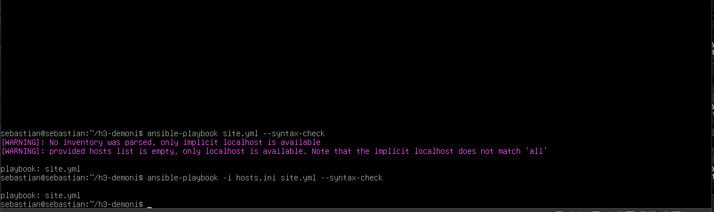
Suoritin playbookin seuraavalla komennolla:

```bash
ansible-playbook -i hosts.ini site.yml --ask-become-pass
```

`ansible-playbook` käynnistää playbookin suorittamisen. `--ask-become-pass` pyytää ylläpitäjän salasanan, jotta Ansible voi suorittaa ylläpitoa vaativat tehtävät.

Playbook suoritti tehtävät onnistuneesti. Tulosteessa näkyi, että tehtävät onnistuivat eikä virheitä tullut. `changed=0` tarkoitti tässä tapauksessa sitä, ettei järjestelmässä tarvinnut tehdä muutoksia, koska Nginx oli jo asennettu ja käynnissä edellisessä tehtävässä. Tämä on Ansiblen idempotenttisuuden tarkoitus: sama playbook voidaan suorittaa useita kertoja ilman tarpeettomia muutoksia.

Suorituksen yhteydessä näkyi myös Python-tulkin löytämiseen liittyvä varoitus. Se ei estänyt playbookin suorittamista.

Playbookin onnistunut suoritus
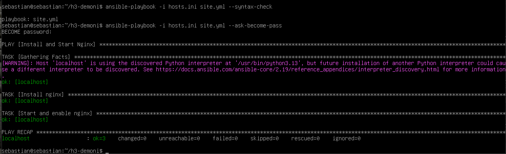
Lopuksi tarkistin vielä palveluiden tilat:

```bash
systemctl is-active nginx apache2
```

Nginx oli aktiivinen ja Apache oli pysäytettynä. Avasin myös verkkosivun selaimessa ja varmistin, että se näkyi edelleen oikein.


Lopputilanne – Nginx aktiivinen, Apache inactive ja verkkosivu toimii 

---


## Lähteet

- Karvinen, Tero. [Apache installed with Ansible – quick notes](https://terokarvinen.com/apache-ansible/)
- Ansible Community Documentation. [Handlers: running operations on change](https://docs.ansible.com/projects/ansible/latest/playbook_guide/playbooks_handlers.html)
- Ansible Documentation. `ansible-doc apt` ja `ansible-doc service`.
- Hacker News. https://thehackernews.com/2026/11/n-able-patches-17-n-central-flaws-as.html? 
