**H4-Pizzafantasia**

**x) Lue ja tiivistä**

Karvinen 2023: Configuration Management of Distributed Systems over Unreliable and Hostile Networks

Luku 4.12.1 – Size and Complexity of Some DSLs

- Konfiguraationhallintatyökalut käyttävät usein omia ohjelmointikieliään eli DSL-kieliä (Domain Specific Language).

- Suuri määrä toimintoja tekee järjestelmistä monimutkaisempia ja niiden opettelusta vaikeampaa.

**Oma huomio:** Kaikkien toimintojen opettelu ei ole tarpeellista, sillä tavallisessa palvelinhallinnassa käytetään usein vain pientä osaa ominaisuuksista.

Luku 4.12.2 – Use of DSL Functions in Case Configuration

- Tutkitaan Mozilla Release Engineeringin ja Yhdysvaltain hallinnon Puppet-konfiguraatioita.

- Tutkimuksessa havaittiin, että suuri osa käytetyistä toiminnoista liittyi tiedostojen käsittelyyn, ohjelmistojen asentamiseen ja palveluiden hallintaan.

- Erityisen yleinen toimintamalli oli package-file-service, jossa ensin asennetaan ohjelmisto, sitten määritetään sen asetukset ja lopuksi varmistetaan palvelun toiminta.

- Tutkimus osoitti, että käytännössä pieni määrä toimintoja riittää moniin tavallisiin palvelinhallinnan tehtäviin.

**Oma huomio:** Tämä näkyi myös omassa työssäni, sillä Redis-palvelimen automatisointi onnistui muutamalla Ansible-moduulilla.

Luku 4.12.3.1 – Dependencies Between Main Functions

- Konfiguraationhallinnan tärkeimpiä toimintoja ovat ohjelmistojen asentaminen, tiedostojen hallinta, palveluiden käynnistäminen sekä käyttäjien ja ryhmien hallinta.

- Esimerkiksi palvelu pitää käynnistää uudelleen silloin, kun sen asetustiedosto muuttuu. Turhia uudelleenkäynnistyksiä tulee välttää.

- Toimintojen väliset riippuvuudet voidaan toteuttaa esimerkiksi siten, että tiedoston muuttuminen käynnistää palvelun uudelleen.

**Oma huomio:** Ansible-handlerin käyttäminen Redis-palvelun uudelleenkäynnistämiseen oli hyvä esimerkki tästä toimintatavasta.

**a) Räpylä**
Tässä tehtävässä asensin Debian 13 -virtuaalikoneelle Redis-palvelimen. Redis on avoimen lähdekoodin tietovarasto, joka säilyttää tietoa avain-arvo-pareina. Sitä voidaan käyttää esimerkiksi välimuistina ja sovellusten tietojen tallentamiseen.

Aloitin päivittämällä paketinhallinnan tiedot ja asentamalla Redis-palvelimen:
sudo apt-get update
sudo apt-get install redis-server
sudo suorittaa komennon ylläpitäjän oikeuksilla. apt-get update päivittää pakettilähteiden tiedot, ja apt-get install asentaa halutun ohjelmistopaketin.

Asennuksen yhteydessä järjestelmä asensi myös Redis-palvelimen tarvitsemat lisäpaketit, kuten redis-tools.

Redis-palvelimen asentaminen terminaalissa.
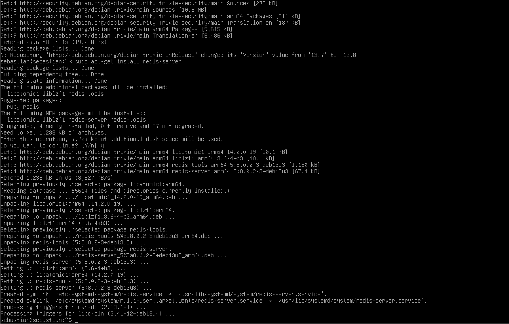

Tarkistin asennuksen jälkeen palvelun tilan:
sudo systemctl status redis-server
systemctl on Linuxin palveluiden hallintaan tarkoitettu työkalu. status näyttää palvelun tilan ja muita tietoja.

Tulosteessa näkyi active (running), mikä tarkoitti, että Redis-palvelin oli käynnissä. Lisäksi palvelun tila oli enabled, joten se käynnistyy automaattisesti järjestelmän käynnistyessä.

Redis-palvelun aktiivinen tila.
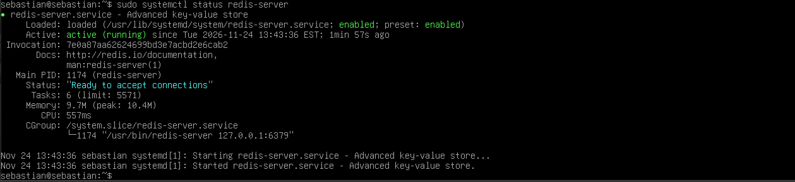

Testasin seuraavaksi Redis-palvelimen toimintaa:
redis-cli ping
redis-cli on Redis-palvelimen komentorivityökalu. ping lähettää palvelimelle testipyynnön. Vastaukseksi sain PONG, mikä vahvisti, että Redis vastasi oikein.

Redis-palvelimen PONG-vastaus.

**b) Automaatti**
Seuraavaksi automatisoin Redis-palvelimen asennuksen ja hallinnan Ansiblella.

Loin tehtävää varten oman projektihakemiston:
mkdir ~/h4-pizzafantasia
cd ~/h4-pizzafantasia
mkdir luo uuden hakemiston ja cd siirtyy kyseiseen hakemistoon.

Projektin sisälle loin Redis-roolin hakemistorakenteen:
mkdir -p roles/redis/tasks
mkdir -p roles/redis/handlers
Ansible-rooli jakaa automaation pienempiin osiin. Tässä tapauksessa Redis-palvelimen asennus, asetukset ja palvelun hallinta sijoitettiin omaan rooliinsa.

Loin myös site.yml-tiedoston, joka määrittää suoritettavan playbookin:
---
- name: Configure Redis server
  hosts: localhost
  become: yes
  roles:
    - redis
Playbookin tärkeimmät asetukset:
- name määrittää tehtävän nimen.
- hosts määrittää hallittavan koneen. Käytin localhost-arvoa, koska hallitsin paikallista Debian-virtuaalikonetta.
- become: yes mahdollistaa komentojen suorittamisen ylläpitäjän oikeuksilla.
- roles määrittää käytettävän Ansible-roolin.

site.yml-tiedoston sisältö.
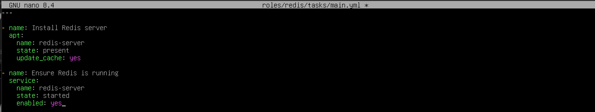

Redis-roolin tehtävät
Loin seuraavaksi tiedoston:
nano roles/redis/tasks/main.yml
Tiedostoon määritin Redis-palvelimen asennuksen ja käynnistyksen:
- name: Install Redis server
  apt:
    name: redis-server
    state: present
    update_cache: yes

- name: Ensure Redis is running
  service:
    name: redis-server
    state: started
    enabled: yes
Ensimmäisessä tehtävässä käytetään Ansiblen apt-moduulia. Se huolehtii Redis-paketin asentamisesta.
- name määrittää asennettavan paketin.
- state: present varmistaa, että paketti on asennettuna.
- update_cache: yes päivittää pakettilähteiden tiedot ennen asennusta.
Toisessa tehtävässä käytetään service-moduulia Linux-palvelun hallintaan.
- name määrittää hallittavan palvelun.
- state: started varmistaa, että Redis on käynnissä.
- enabled: yes määrittää, että palvelu käynnistyy automaattisesti käyttöjärjestelmän käynnistyessä.

Redis-roolin main.yml-tiedosto.
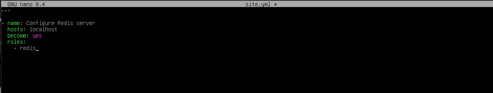
Redis-asetustiedoston muokkaaminen
Seuraavaksi tein oman Redis-asetustiedoston nimeltä redis.conf.

Tiedostossa muokkasin lokitustasoa:
loglevel warning
Redis-palvelimen lokitustaso määrittää, kuinka paljon tietoa palvelin kirjoittaa lokiin. warning tarkoittaa, että lokiin tallennetaan varoitukset ja niitä vakavammat ilmoitukset.

Asetustiedoston avulla voidaan hallita Redis-palvelimen toimintaa keskitetysti.

redis.conf-tiedoston lokiasetus.
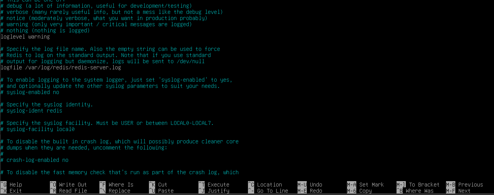

Lisäsin main.yml-tiedostoon tehtävän, joka kopioi asetustiedoston palvelimen oikeaan hakemistoon:
- name: Copy Redis configuration
  copy:
    src: redis.conf
    dest: /etc/redis/redis.conf
    owner: root
    group: redis
    mode: '0640'
  notify: Restart Redis
Tässä käytetään Ansiblen copy-moduulia.
- src määrittää kopioitavan tiedoston.
- dest määrittää tiedoston kohdesijainnin.
- owner määrittää tiedoston omistajan.
- group määrittää tiedoston käyttäjäryhmän.
- mode: '0640' määrittää tiedoston käyttöoikeudet.
- notify ilmoittaa handlerille, että Redis pitää käynnistää uudelleen, jos asetustiedostoon tulee muutoksia.
Käyttöoikeudessa 0640 omistajalla on luku- ja kirjoitusoikeus, ryhmällä lukuoikeus ja muilla käyttäjillä ei ole oikeuksia.

Redis-asetustiedoston kopiointitehtävä.
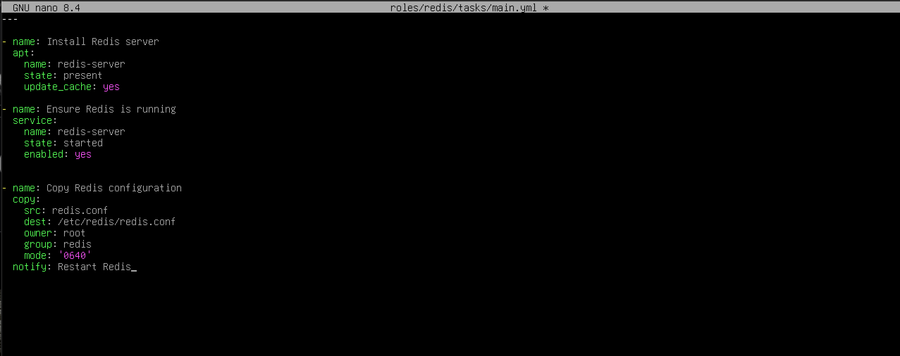

Handlerin luominen
Loin seuraavaksi handler-tiedoston:
nano roles/redis/handlers/main.yml
Lisäsin tiedostoon seuraavan sisällön:
- name: Restart Redis
  service:
    name: redis-server
    state: restarted
Handler on Ansible-tehtävä, joka suoritetaan vain silloin, kun jokin toinen tehtävä ilmoittaa muutoksesta notify-asetuksella.

Tässä tapauksessa Redis-palvelu käynnistetään uudelleen, jos sen asetustiedostoa muutetaan. Näin uudet asetukset tulevat käyttöön ilman tarpeettomia uudelleenkäynnistyksiä.

Handler-tiedoston sisältö.
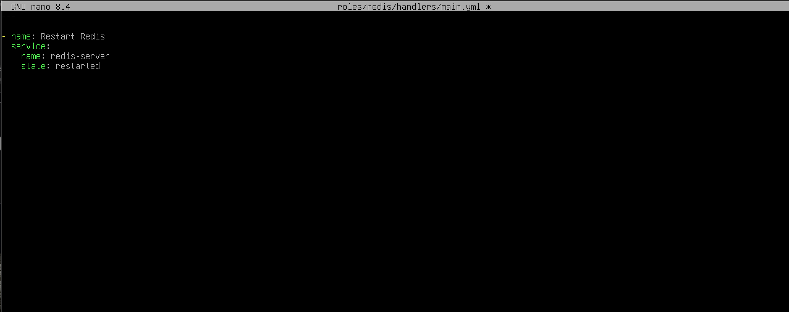

**c) Asetus**
Kun tarvittavat tiedostot olivat valmiina, suoritin playbookin projektihakemistossa:
ansible-playbook -i hosts.ini site.yml --ask-become-pass
Komennon osat:
- ansible-playbook käynnistää playbookin suorittamisen.
- -i hosts.ini määrittää inventaariotiedoston, jossa määritellään hallittavat koneet.
- site.yml on suoritettava playbook.
- --ask-become-pass pyytää ylläpitäjän salasanan, jotta Ansible voi suorittaa ylläpitoa vaativat tehtävät.
Ensimmäisellä suorituskerroilla Ansible suoritti Redis-palvelimen asennuksen, varmisti palvelun käynnissäolon ja kopioi asetustiedoston paikalleen.

Tulosteessa näkyi myös changed-merkintöjä. Tämä tarkoittaa, että Ansible teki järjestelmään muutoksia.

Suoritus päättyi onnistuneesti. Tuloksena oli failed=0, joten tehtävässä ei ollut virheitä.

Ansible-playbookin ensimmäinen onnistunut suoritus.
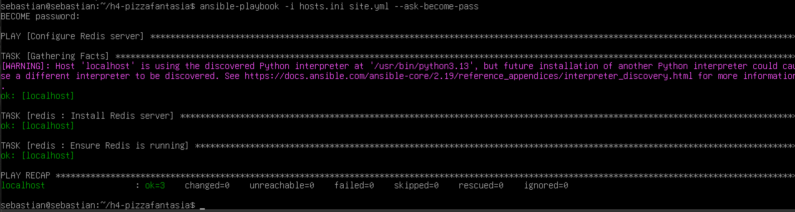

Playbookin suorittaminen uudelleen
Suoritin playbookin uudelleen samalla komennolla:
ansible-playbook -i hosts.ini site.yml --ask-become-pass
Tällä kertaa tulosteessa näkyi, että tehtävät olivat jo kunnossa eikä tarpeettomia muutoksia tarvinnut tehdä.

Playbookin uudelleen suorittaminen ilman muutoksia.
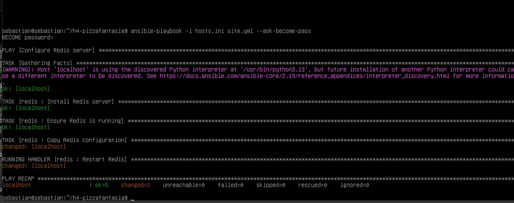

Asetuksen muuttamisen testaaminen
Testasin myös asetustiedoston muutoksen vaikutusta. Kun Redis-asetustiedosto kopioitiin uudelleen palvelimelle, Ansible tunnisti muutoksen ja suoritti Restart Redis -handlerin.

Tulosteessa näkyi:
- changed, kun asetustiedosto muuttui.
- RUNNING HANDLER [redis : Restart Redis], kun Redis käynnistettiin uudelleen.
Näin varmistin, että handler toimii oikein ja palvelu käynnistyy uudelleen asetusten muuttuessa.

Redis-asetuksen tarkistaminen
Tarkistin vielä Redis-palvelimen käyttämän lokitustason:
redis-cli CONFIG GET loglevel
Komento hakee Redis-palvelimen asetuksista loglevel-arvon.

Vastauksessa näkyi:
1) "loglevel"
2) "warning"
Tämä vahvisti, että muokkaamani asetus oli käytössä Redis-palvelimessa.

Redis-palvelimen loglevel-asetuksen tarkistaminen.
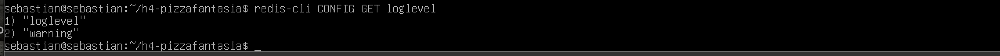

**d) Paikka remonttiin**

Aloitin poistamalla Redis-palvelimen Debian-virtuaalikoneelta:

sudo apt-get purge redis-server

sudo suorittaa komennon ylläpitäjän oikeuksilla. apt-get purge poistaa Redis-palvelimen sekä siihen liittyvät asetustiedostot. 

Redis-palvelimen poistaminen purge-komennolla.
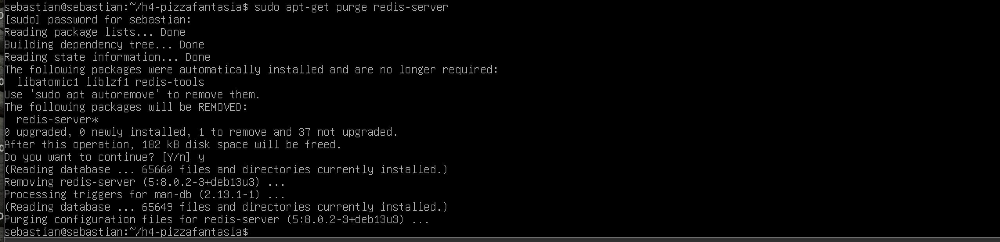

Poistamisen jälkeen suoritin Ansible-playbookin uudelleen:

ansible-playbook -i hosts.ini site.yml --ask-become-pass

Ansible kävi roolin tehtävät läpi järjestyksessä. Ensimmäisenä se tarkisti Redis-paketin asennuksen. Koska olin poistanut ohjelmiston, Ansible asensi sen uudelleen. Seuraavaksi Ansible varmisti palvelun käynnissäolon ja kopioi Redis-asetustiedoston takaisin oikeaan sijaintiin.

Jos asetustiedosto muuttui, Ansible suoritti myös Restart Redis -handlerin, jolloin palvelu käynnistettiin uudelleen.

Ansible-playbookin suorittaminen Redis-palvelimen poistamisen jälkeen ja sen palauttaminen.
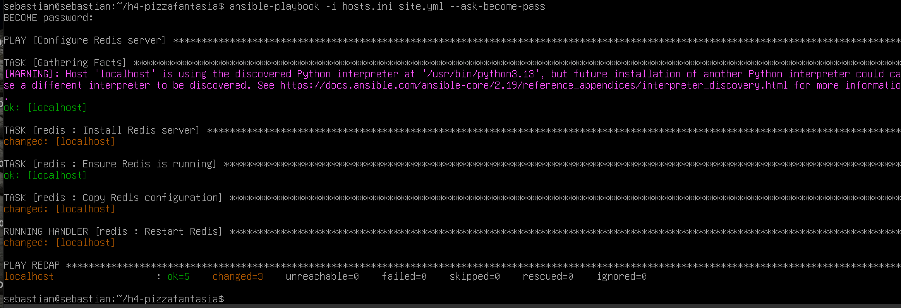

**e) Idempotentti**

Viimeisessä vaiheessa testasin Ansible-automaation idempotenttisuutta.

Idempotenttisuus tarkoittaa sitä, että sama automaatiokomento voidaan suorittaa useita kertoja ilman, että järjestelmään tehdään tarpeettomia muutoksia. Ansible tarkistaa järjestelmän nykyisen tilan ja vertaa sitä playbookissa määriteltyyn tavoitetilaan.

Suoritin saman playbookin uudelleen:

ansible-playbook -i hosts.ini site.yml --ask-become-pass

Tällä kertaa kaikki tehtävät olivat jo tavoitetilassa, joten Ansible ei joutunut tekemään muutoksia.

Suorituksen lopussa näkyi seuraava yhteenveto:

localhost : ok=4 changed=0 unreachable=0 failed=0

Tuloksen merkitys:

ok=4 tarkoittaa, että neljä tehtävää suoritettiin onnistuneesti.

changed=0 tarkoittaa, ettei järjestelmään tehty muutoksia.

unreachable=0 tarkoittaa, että hallittavaan koneeseen saatiin yhteys.

failed=0 tarkoittaa, ettei tehtävissä ollut virheitä.

Playbookin suorittaminen uudelleen ja changed=0-tulos.
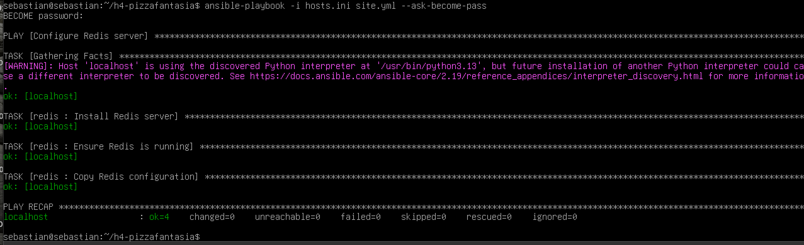

**f) Pasila ryhmä**

Pari on ilmoitettu moodleen.

**Lähteet**

Karvinen, T. 2026. Palvelinten Hallinta – H4 Pizza Fantasia. https://terokarvinen.com/palvelinten-hallinta/

Karvinen, T. 2026. Hello Ansible. https://terokarvinen.com/palvelinten-hallinta/

Karvinen, T. 2025. Pkg-File-Service – Control Daemons with Salt. https://terokarvinen.com/2025/palvelinten-hallinta-ici001as3a-3012-2025p2/

Ansible Community Documentation. Ansible Documentation. https://docs.ansible.com/

Ansible Community Documentation. Handlers: Running Operations on Change. https://docs.ansible.com/projects/ansible/latest/playbook_guide/playbooks_handlers.html

Redis Documentation. Install Redis on Linux. https://redis.io/docs/latest/operate/oss_and_stack/install/install-redis/install-redis-on-linux/

Redis Documentation. Redis Configuration. https://redis.io/docs/latest/management/config/

Tekoälyä käytetty käsitteiden ja käskyjen avaamiseen.
